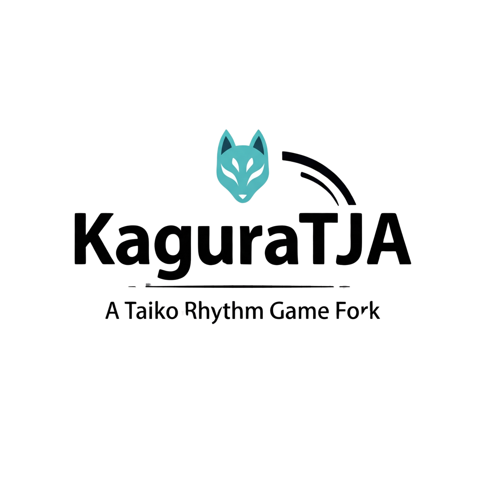

  

# KaguraTJA

**OpenTaiko** のベースエディションを改良した非公式の派生・改造プロジェクトです（AIの支援を活用して開発されています）。元の **OpenTaiko**（旧称 `TJAPlayer3-Develop-BSQ`）および `TJAPlayer3` コミュニティの基盤の上に構築されています。

- ベースプロジェクト (OpenTaiko): https://github.com/0auBSQ/OpenTaiko
- OpenTaiko Discord : https://discord.gg/aA8scTvZ6B
- OpenTaiko Discord (日本語) : https://discord.gg/CJ4nTkpy7t

## 使用上の注意 （重要）

- 本派生ビルド（KaguraTJA）は、AIの支援を受けて改良・変更を加えた非公式の改造版です。使用および導入は**全て自己責任**でお願いします。

- 元の OpenTaiko 開発チームや公式サポート窓口へ、KaguraTJA 固有の不具合・改造内容・設定に関する問い合わせを行わないでください。

- 著作権を侵害するスキン、譜面、または無断転載・再配布に関するサポートや助言は一切行いません。

- 質問や調査の前に、まずは関連ドキュメントやソースコードをご確認ください（OpenTaiko の[取扱説明書](https://drive.google.com/file/d/1VJoia2M_EWrf58xsATL7udIJ0ozR2YFf/view?usp=sharing)や[Wiki](https://seesaawiki.jp/opentaiko-unofficial/)も参考になります）。

- 常時60fpsを安定して維持できない環境では、快適な動作やプレイは期待できません。

### 動画、配信等でのご利用について

- 動画投稿や配信を行う際は、視聴者の混乱を防ぐため、本プロジェクト名（**KaguraTJA**）や派生元である **OpenTaiko** などのタグを適切に付与することを推奨します。

- 知的財産権および各権利者の利用規約を尊重し、お住まいの国・地域の著作権法に従ってご利用ください。著作権を侵害する素材やスキンの配布・公開には賛同しません。

### 改造・再配布(二次配布)を行う場合について

- ベースとなる **OpenTaiko** は MIT ライセンスのオープンソースソフトウェアです。MIT ライセンスの条件に従う限り、改変や再配布は可能ですが、**全て自己責任**となります。

- 使用されている各種ライブラリのライセンス要件に基づき、**必ず** `Licenses` フォルダを同梱した状態で配布・共有してください。

- 外部スキンや譜面パック等を同梱する場合は、それぞれの制作者が定める利用規約やライセンスに従ってください。それらには OpenTaiko および KaguraTJA のライセンスは適用されません。

### 目標・目標ではないこと

**目標**

- OpenTaiko のベースエディションを土台として、描画や演出、プレイ体験、ユーザビリティ（QoL）などの改善・拡張を進めること。

- カスタマイズ性やメンテナンス性を高め、より扱いやすい構成を目指すこと。

- 最適化や不具合の修正を進めること。

**目標ではない**

- 特定の商用リズムゲームをそのまま再現・模倣すること。

## IssueとPull Request投稿上の注意 （重要）

KaguraTJA に関する Issue や Pull Request をお送りいただく場合は、以下の点にご協力ください。

- 投稿内容は関連する著作権法および各国の法令・ガイドラインに従ってください。

- 不具合報告（Issue）の際は、利用しているバージョン・コミット情報と再現手順をできるだけ詳しく記載してください。クラッシュが発生した場合はログファイルの内容も添付してください。

- AI支援による生成・修正コードが含まれる場合があることを踏まえ、動作確認やレビューにご協力をお願いいたします。

### 提案について

- 機能追加や改善案がある場合は、Issue または指定の連絡先までお寄せください。すべての提案が採用されるわけではありませんのであらかじめご了承ください。

## スペシャルサンクス

KaguraTJA は **OpenTaiko** および歴代の `TJAPlayer3` / 関連プロジェクトの成果と貢献者の方々の尽力なしには成り立ちません。心より感謝申し上げます。

> * [0auBSQ / OpenTaiko](https://github.com/0auBSQ/OpenTaiko)
> * [Takkkom/Major OpenTaiko features (1080p support, AI Battle mode, 5P mode and so on)](https://github.com/Takkkom)
> * [AkiraChnl/OpenTaiko Icon](https://github.com/AkiraChnl)(@akirach_jp)
> * [Reichisama/OpenTaiko 0.6.0 Icon](https://twitter.com/himikoreichi135)(@himikoreichi135)
> * [cien/OpenTaiko Logo/Various Default Skin Assets](https://twitter.com/CienpixeL)(@CienpixeL)
> * [funnym0th/OpenTaiko Spanish Translation](https://github.com/funnym0th) (@funnym0th)
> * [basketballsmash/English README Translation](https://twitter.com/basketballsmash)(@basketballsmash)
> * [Meowgister/OpenTaiko English Translation](https://www.youtube.com/channel/UCDi5puZaJLMUA6OgIAb7rmQ)
> * [WHMHammer/OpenTaiko Chinese Translation](https://github.com/whmhammer)(@WHMHammer)
> * [Expédic Habbet/OpenTaiko Chinese and Spanish Text Assistance, Russian Text](https://github.com/ExpedicHabbet)(@ExpedicHabbet)
> * [Aioilight/TJAPlayer3](https://github.com/aioilight/TJAPlayer3)(@aioilight)
> * [TwoPointZero/TJAPlayer3](https://github.com/twopointzero/TJAPlayer3)(@twopointzero)
> * [KabanFriends/TJAPlayer3](https://github.com/KabanFriends/TJAPlayer3/tree/features)(@KabanFriends)
> * [Mr-Ojii/TJAPlayer3-f](https://github.com/Mr-Ojii/TJAPlayer3-f)(@Mr-Ojii)
> * [Akasoko/TJAPlayer3](https://github.com/Akasoko-Master/TJAPlayer3)(@AkasokoR)
> * [FROM/DTXMaina](https://github.com/DTXMania)(@DTXMania)
> * [Kairera0467/TJAP2fPC](https://github.com/kairera0467/TJAP2fPC)(@Kairera0467)
> * [touhourenren/TJAPlayer3-Develop-Rewrite](
